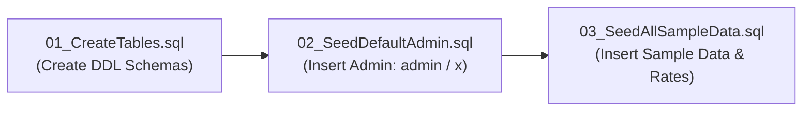

# 🏛️ City Assessor System - Database SQL Scripts & Execution Sequence

This folder contains all database initialization scripts, table DDL schemas, and default administrator seed data for the **City Assessor Real Property Tax & FAAS Assessment Management System**.

---

## 🔑 Default Administrator Login Credentials

After executing the SQL scripts, you can log in to the application using the default system administrator account:

| Field | Default Value | Notes |
| :--- | :--- | :--- |
| **Username** | `admin` | System Administrator Account |
| **Password** | `P@ssword2026!` | Default Password |
| **User Role** | `SystemAdministrator` | Full Access Permissions |
| **Department** | `City Assessor Executive Office` | Primary LGU Division |
| **Email** | `admin@gensan.gov.ph` | Official Assessor Email |

---

## 📜 SQL Script Execution Sequence

To properly set up the database from scratch, execute the SQL script files in the following exact sequence:



### 1. `01_CreateTables.sql`
- **Purpose:** Creates all required relational database tables and indexes.
- **Tables Created:**
  - `UserAccounts`: Stores staff user accounts, hashed passwords, roles, and status.
  - `TaxpayerOwners`: Master table for property owner records and TIN numbers.
  - `TaxDeclarations`: Real Property Tax Declarations & FAAS assessment records.
  - `OrderPayments`: Schedule of fees, particulars, and unit costs.
  - `TaxMappingRequests`: GIS spatial mapping requests, receipts, certificate options, and fees.

---

### 2. `02_SeedDefaultAdmin.sql`
- **Purpose:** Seeds the primary **Default System Administrator Account**.
- **Credentials Created:**
  - **Username:** `admin`
  - **Password:** `admin` (or `x`)
  - **Account Status:** Active (`TRUE`)
  - **Role ID:** `0` (`SystemAdmin`)

---

### 3. `03_SeedAllSampleData.sql`
- **Purpose:** Seeds sample staff accounts, Order of Payment fee schedules, registered property tax declarations, and GIS mapping requests.
- **Includes:**
  - Order of Payment Fee Schedule (CTC, RROW, Identification Certs, Tax Map Prints).
  - Pre-registered Tax Declarations (Residential & Commercial sample properties).
  - Staff Accounts (City Assessor Head, Appraisers, Tax Mappers, Clerks).

---

### 8. `08_SeedDefaultRolePermissions.sql`
- **Purpose:** Seeds default role permissions in `RoleModulePermission` across all active workflow modules.

---

### 9. `09_SeedBuildingClassifications.sql`
- **Purpose:** Creates and seeds the reference building classifications table `[dbo].[BuildingClassifications]` with the 18 standard CAST structural BUCC classes and building use classifications (Class A-E, Residential One-Family/Multi-Family, Commercial, Industrial, Institutional, Special, Agricultural).

---

### 12. `12_SeedDefaultModules.sql`
- **Purpose:** Seeds the 18 default system modules into `[dbo].[SystemModule]` with deterministic Module IDs, routing controllers/actions, categories, and Lucide icons.
- **Includes:** Dashboard, Pool Transactions, My Transactions, Analytics, Inspection, Property Assessment, FAAS/Assessment, Tax Mapping, Tax Declaration, Land Holdings, Order of Payment, Owner Registration, File Location, Workflow Settings, User Management, User Roles, Role Permissions, Data Transfer.

---

### 13. `13_SeedDefaultUserRoles.sql`
- **Purpose:** Seeds the 22 default user roles into `[dbo].[UserRoleSettings]` with deterministic GUIDs, workflow step associations (`TransactionStatusId`), and division assignments (Division 1 Appraisal & Assessment, Division 2 Tax Mapping, Division 3 Records, plus System Administrator).

---

### 14. `14_RenameLandPrerequisiteTables.sql`
- **Purpose:** Standardizes all TDN Land prerequisite lookup tables by prefixing `Land` (e.g. `LandRefClassification`, `LandRefSubClassification`, `LandRefActualUse`, `LandRefAssessmentLevel`, `LandRefAdjustment`, `LandRefImprovementType`). Safely renames legacy tables with `sp_rename` or creates and seeds them.

---

### 15. `15_SeedDefaultProvincesCitiesBarangays.sql`
- **Purpose:** Seeds master geographic locations into `[dbo].[Provinces]`, `[dbo].[CityMunicipalities]`, and `[dbo].[Barangays]`, including all 26 official Barangays of General Santos City and South Cotabato with deterministic GUIDs matching `GeographicService`.

---

## 🚀 How to Execute SQL Scripts

### Option A: PostgreSQL / PostGIS
```bash
psql -U postgres -d AssessorDb -f 01_CreateTables.sql
psql -U postgres -d AssessorDb -f 02_SeedDefaultAdmin.sql
psql -U postgres -d AssessorDb -f 03_SeedAllSampleData.sql
```

### Option B: Microsoft SQL Server (SSMS / sqlcmd)
```bash
sqlcmd -S localhost -d AssessorDb -i 01_CreateTables.sql
sqlcmd -S localhost -d AssessorDb -i 02_SeedDefaultAdmin.sql
sqlcmd -S localhost -d AssessorDb -i 03_SeedAllSampleData.sql
```

### Option C: DBeaver / pgAdmin / DataGrip UI
1. Open your database management GUI tool.
2. Connect to your local or remote database instance.
3. Open a SQL Query Console window.
4. Open and execute `01_CreateTables.sql`.
5. Open and execute `02_SeedDefaultAdmin.sql`.
6. Open and execute `03_SeedAllSampleData.sql`.

---

> [!TIP]
> In-memory application execution uses `IUserAccountService`, which is pre-configured with the default `admin` / `x` account out of the box!
