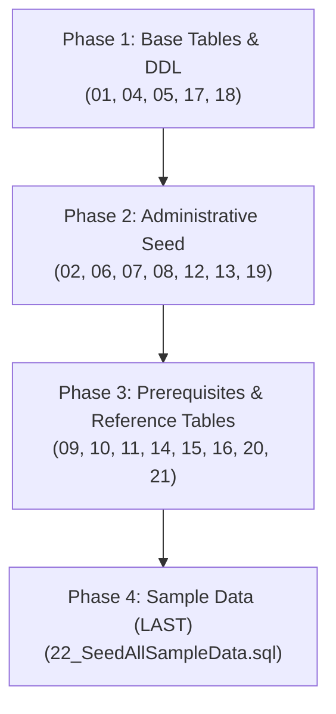

# 🏛️ City Assessor System - Database SQL Scripts & Execution Sequence

This folder contains all database initialization scripts, table DDL schemas, prerequisite lookup tables, and default seed data for the **City Assessor Real Property Tax & FAAS Assessment Management System**.

---

## 🔑 Default Administrator Login Credentials

After executing the SQL scripts, you can log in to the application using the default system administrator account:

| Field | Default Value | Notes |
| :--- | :--- | :--- |
| **Username** | `admin` | System Administrator Account |
| **Password** | `P@ssword2026!` | Default Password |
| **User Role** | `SystemAdministrator` | Full Access Permissions |
| **Department** | `City Assessor Executive Office` | Primary LGU Division |
| **Email** | `admin@gensan.gov.ph` | Official Assessor Email |

---

## 🚀 How to Execute All Scripts Automatically

You can run all scripts in sequence using either of these two automated options:

### Option A: Master SQL Script in SSMS (`00_RunAllScripts_Master.sql`)
1. Open [`00_RunAllScripts_Master.sql`](file:///C:/Users/HP_02/Desktop/PropertyAssessmentApp/SqlScripts/00_RunAllScripts_Master.sql) in SQL Server Management Studio (SSMS).
2. Enable **SQLCMD Mode**: in the SSMS top menu bar, click **Query** ➔ **SQLCMD Mode** (it will highlight).
3. Connect to your database and click **Execute** (or press `F5`).
   It executes all 21 scripts sequentially from your local directory with progress indicators for each step.

### Option B: PowerShell Automation Runner (`run_all_scripts.ps1`)
Run the provided PowerShell script in terminal:
```powershell
# For local SQL Server (Windows Authentication):
.\run_all_scripts.ps1 -Server "localhost" -Database "PropertyAssessmentDb"

# For Cloud SQL Database (SQL Authentication):
.\run_all_scripts.ps1 -Server "your-cloud-sql.database.windows.net" -Database "AssessorDb" -Username "cloudadmin" -Password "YourPassword!"
```

---

## 📜 Proper Script Execution Sequence

When setting up a database using raw SQL scripts (or restoring reference schemas), run the scripts strictly in the numbered numerical order below. 

> [!IMPORTANT]
> **Prerequisites & Reference Lookups (Steps 09 to 21)** MUST run before **Sample Data (Step 22)**. Tax Declarations and FAAS appraisals require the classifications, actual uses, assessment levels, and depreciation rates to exist first.



---

### Step-by-Step Order:

#### Phase 1: Core Tables & Schema DDL
1. **`01_CreateTables.sql`**  
   Creates primary tables: `UserAccounts`, `TaxpayerOwners`, `TaxDeclarations`, `TDNLands`, `TDNBuildings`, `OrderPayments`, `TaxMappingRequests`.
2. **`04_SeedFileLocationDefaultSetup.sql`**  
   Creates and populates `FileLocation` table with network and web storage upload roots.
3. **`05_CreateInspectionAndAssessmentRequestTables.sql`**  
   Creates `RequestForInspections` and `PropertyAssessmentRequests` tables (including `OwnerId` index).
4. **`17_AddTransactionTypeToRequestForInspection.sql`**  
   Adds transaction classification columns to `RequestForInspections`.
5. **`18_AddCancellationAndSupersedingColumnsToTaxDeclaration.sql`**  
   Adds cancellation tracking (`IsCancelledAndSuperseded`, `CancellationReason`) to `TaxDeclarations`.

#### Phase 2: System Setup, Modules & Admin User
6. **`02_SeedDefaultAdmin.sql`**  
   Seeds default admin account (`admin` / `P@ssword2026!`).
7. **`12_SeedDefaultModules.sql`**  
   Seeds the 18 standard system modules into `[dbo].[SystemModule]`.
8. **`13_SeedDefaultUserRoles.sql`**  
   Seeds the 22 user roles into `[dbo].[UserRoleSettings]`.
9. **`06_SyncUserRolesWithWorkflowSteps.sql`**  
   Synchronizes `UserRoleSettings` with workflow stages.
10. **`08_SeedDefaultRolePermissions.sql`**  
    Seeds permissions across modules in `[dbo].[RoleModulePermission]`.
11. **`19_SeedTransactionStatusesAndWorkflowSequences.sql`**  
    Seeds official transaction statuses and multi-division workflow sequences.
12. **`07_ImportUsersFromCast.sql`** *(Optional)*  
    Imports standard LGU staff accounts exported from CAST reference system.

#### Phase 3: Reference Lookups & Appraisal Prerequisites
13. **`09_SeedBuildingClassifications.sql`**  
    Seeds 18 standard CAST structural BUCC classes into `[dbo].[BuildingClassifications]`.
14. **`10_SeedBuildingAdditionalItems.sql`**  
    Seeds 52 standard building additional items / improvements into `[dbo].[BuildingAdditionalItem]`.
15. **`11_SeedBuildingAssessmentDepreciationAndRates.sql`**  
    Seeds building valuation and rate reference tables.
16. **`14_SeedLandPrerequisitesAndTables.sql`**  
    Creates and seeds Land lookups: `LandRefClassification`, `LandRefSubClassification`, `LandRefActualUse`, `LandRefAssessmentLevel`, `LandRefAdjustment`, `LandRefImprovementType`.
17. **`15_SeedDefaultProvincesCitiesBarangays.sql`**  
    Seeds master geographic locations for South Cotabato & General Santos City (all 26 Barangays).
18. **`16_SeedMachineryPrerequisitesAndTables.sql`**  
    Creates and seeds Machinery lookups: `MachineryRefActualUse`, `MachineryRefAssessmentLevel`, `TDNMachineryDetails`, `TDNMachineryPropertyAssessments`.
19. **`20_CreateAndSeedBuildingDepreciationSchedule.sql`**  
    Creates and seeds `BuildingDepreciationScheduleItems` schedule matrix.
20. **`21_UpdateBuildingStructuralMaterials.sql`**  
    Updates building structural materials aligned with local assessment guidelines.

#### Phase 4: Sample Data (MUST BE RUN LAST)
21. **`22_SeedAllSampleData.sql`**  
    Seeds sample property owners (`TaxpayerOwners`), sample Real Property Tax Declarations (`TDNLands`, `TDNBuildings`), order of payment billings, and sample GIS requests.
